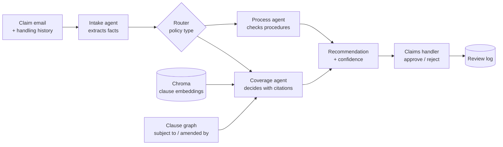

# ClaimFlow

ClaimFlow does the first pass on an insurance claim email. It reads the customer's first notice of loss, pulls out the facts, checks the policy wording, including the exclusions and endorsements that clauses point to, and checks the claim's handling history against the claims procedures. It then gives the claims handler a recommendation that cites the exact clauses and procedure sections it relies on. The handler approves or rejects it, and the decision is logged.

**Live demo:** https://claimflow-j2tbrttyzhynbufmk9usxz.streamlit.app

 

## How it works



- **Intake agent.** Turns the email into a typed record: claimant, policy number, policy type, incident date, type and place, documents attached, and severity under the intake procedure's rule. Code then works out which documents are still needed from the checklist.
- **Router.** Picks motor, home or health from the policy-number prefix and the intake agent's reading. If the two disagree, the claim goes to a person. This step uses rules only.
- **Coverage agent.** Finds the relevant clauses and recommends *covered*, *not covered* or *refer to a handler*. Every clause it cites must come with a quote that appears word for word in that clause.
- **Process agent.** Compares the claim's handling history with the procedures and reports problems. Examples are a document requested twice, a check repeated, a step done out of order, or a wait longer than allowed. Each problem comes with a fix that cites a procedure section.
- **Supervisor.** Assembles the recommendation and sets the confidence level from fixed rules. It also writes the record to the review log.

**Why a clause graph.** Policy wordings point to each other. A cover can be "subject to Exclusion 4.2", which is in turn "amended by Endorsement 6.1". The clause that decides a claim often shares few words with the customer's email, so plain similarity search misses it. ClaimFlow takes the five most similar clauses and then follows the explicit references between clauses, up to two steps, so the agent also sees the exclusions, endorsements and definitions involved.

**Checks on the model.**
- Every answer is validated against a schema. An invalid answer gets one retry and then fails safely.
- A citation is dropped if its clause wasn't retrieved or its quote isn't in the clause text.
- A recommendation with no verified citation becomes *refer to a handler*.
- Phone numbers, email addresses and ID numbers are masked before anything is written to the log.

**Cost and limits.**
- All model calls go through one interface, with Gemini as the only implementation.
- Each call is cached on disk, keyed on the model and the exact prompt.
- A delay between calls keeps usage inside the free tier, with exponential backoff on rate-limit errors.
- Every call's latency, token counts, cache hit and success are logged to SQLite and shown on the Monitoring page.

## Results

There are 30 test claims: 10 motor, 10 home and 10 health. Each has a known answer.
- **8** can only be decided by following a cross-reference.
- **3** should be referred to a handler.
- **28** handling problems are hidden in the claims' histories, and 6 claims have none.

Each claim was run through the full system with three ways of finding clauses:
- **Policy graph:** the 5 most similar clauses plus the clauses they refer to.
- **Similarity search:** the 5 most similar clauses only.
- **Same size as graph:** as many similar clauses as the graph method used for that claim. This shows whether the graph helps beyond simply giving the model more text.

| | Policy graph | Same size as graph | Similarity search |
|---|---|---|---|
| Coverage recommendation correct (30 claims) | **83%** (25) | 77% (23) | 67% (20) |
| ... claims that need a cross-reference (8) | **88%** (7) | 63% (5) | 50% (4) |
| Required clauses cited | 80% | 77% | 64% |
| Cited clauses that are relevant | 84% | 91% | 77% |
| Required clauses shown to the agent | 93% | 87% | 78% |
| Decidable claims wrongly referred to a handler | 3 of 27 | 6 of 27 | 5 of 27 |
| Claims correctly referred to a handler | 2 of 3 | 2 of 3 | 2 of 3 |
| Model time per claim (mean / p95) | 8.2 s / 9.5 s | 11.7 s / 14.8 s | 8.1 s / 11.2 s |
| Tokens per claim (mean) | 4,124 | 4,074 | 3,785 |

These parts don't depend on clause search:
- Policy type routed correctly: 100%.
- Claim details extracted correctly: 97%, averaged over 8 fields.
- Handling problems found: 23 of 28. 23 of the 26 flags raised were real problems.
- Fix cites the right procedure section: 19 of 23. There was 1 false alarm across the 6 clean claims.

**What this shows**
- **Following cross-references helped where it was meant to.** 7 of the 8 cross-reference claims were right with the graph. Plain search given the same number of clauses got 5, and search with 5 clauses got 4. With only 8 such claims, though, the gap is two or three claims, not a statistically firm result.
- **Most mistakes are cautious.** The system tends to refer a decidable claim to a handler rather than approve it wrongly, because it refers any claim whose answer it cannot back with a verified quote. One claim (C28) was referred by every method even though the graph showed it every relevant clause: the model didn't apply the endorsement that shortens a waiting period.
- **One refusal was missed by every method.** A claim that should have been referred (wall cracks after a neighbour's excavation) was answered "not covered".

The full numbers are in `eval/results.json` and `eval/results.md`. Every model call from that run is in `eval/model_calls.csv`: 390 calls, 150 sent to the API, the rest served from the cache, and none failed.

## Data

The policies, procedures and claims were written for this project, and the people and the insurer are fictional.
- **Policies:** 3 policy wordings with 60 numbered clauses and 49 cross-references between them.
- **Procedures:** 8 claims-handling procedure documents with 25 sections.
- **Claims:** 30 claim emails, each with a handling history.

Everything is generated from one specification (`data/build_dataset.py`), so the emails, histories and expected answers cannot drift apart. The checks in `data/check_dataset.py` also run in CI:
- Every referenced clause exists.
- No email gives away the answer, through a clause number or a policy term such as "excluded".
- The expected details really appear in each email.
- A separately written checker finds exactly the planted handling problems in each history.

## Run it locally

You need Python 3.10 or newer and a free Gemini API key. To get one, sign in at https://aistudio.google.com, then choose **Get API key → Create API key**. Don't enable billing.

```bash
git clone https://github.com/ashashree2000/claimflow && cd claimflow
python -m venv .venv && source .venv/bin/activate
pip install -r requirements-dev.txt
cp .env.example .env                 # add GEMINI_API_KEY=... to .env

python data/build_dataset.py && python data/check_dataset.py   # build and check the data (no API calls)
python scripts/build_index.py        # embed the clauses into Chroma (3 API calls)

streamlit run app/streamlit_app.py   # the web app
uvicorn api.main:app --reload        # REST API: POST /triage, POST /review/{id}, GET /health, GET /metrics/summary
pytest -q && ruff check .            # tests use a fake model, so no key is needed
python eval/run_eval.py              # re-run the evaluation (about 150 API calls; cached calls are free)
```

The API also runs in Docker. The key is passed in when the container starts and is never stored in the image:

```bash
docker build -t claimflow-api . && docker run --rm -p 8000:8000 --env-file .env claimflow-api
```

GitHub Actions runs linting, the data checks and the tests on every push. A second, manually started workflow runs a 5-claim live evaluation using a repository secret.

## Project layout

```
claimflow/   agents (intake, router, coverage, process, supervisor), retrieval (Chroma + clause graph),
             llm (provider interface, Gemini, cache), guardrails, review log, monitoring
api/         FastAPI service
app/         Streamlit app
data/        policies, procedures, claims, expected answers, and the scripts that build and check them
eval/        evaluation runner, metrics and results
tests/       pytest suite (fake model)
```

## Limitations

- The test set is small and was written for this project. A single claim moves accuracy by 3 to 12 points, and real claims are messier.
- Prompts and retrieval settings were adjusted on 5 of the 30 claims before the single full run.
- The free tier allows 15 requests a minute and 500 a day for the text model. That ruled out the larger Gemini models, which allow 20 a day.
- Only Gemini is implemented, although the interface allows other providers.
- Routing relies on the policy-number prefix.
- Monitoring is a SQLite table and a dashboard, not a production monitoring stack.
