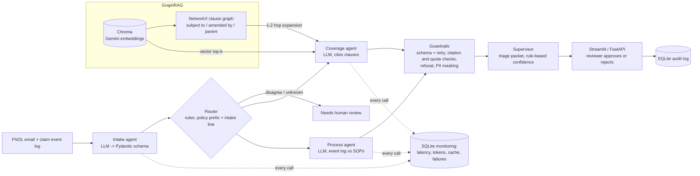

# ClaimFlow

**A multi-agent claims-intake copilot for insurance, with GraphRAG over policy clauses.**

Insurers receive first-notice-of-loss (FNOL) emails that a handler must read, check against the policy wording and the claims-handling procedures, and route. ClaimFlow turns one FNOL email into a triage packet with the extracted facts, a coverage recommendation with clause-level citations, SOP-grounded process flags and fixes, and a confidence level. A human approves or rejects every packet, and each decision is written to an audit log.

> **All data in this repository is synthetic.** The claimants, phone numbers, policies, insurer ("Northwind Mutual"), hospitals and events are invented. No real personal data is used anywhere.

## Architecture



| Component | What it does |
|---|---|
| Intake agent (`claimflow/agents/intake.py`) | Extracts claimant, policy number, line of business, incident date/type/location, attached documents and severity (rubric from SOP-INT-1.3) into a Pydantic model. Missing documents are computed by code from the SOP checklist. |
| Router (`agents/router.py`) | Rules only: policy-number prefix and the intake agent's line of business. If they disagree or neither is known, the claim goes to a human (SOP-INT-1.4). The decision and its reason are logged in the packet. |
| Coverage agent (`agents/coverage.py`) | Retrieves clauses (`vector`, `vector_wide` or `graph` mode) and decides `covered` / `not_covered` / `needs_review`, citing clause IDs with verbatim quotes. |
| Process agent (`agents/process.py`) | Compares the claim's event log with the 25 SOP sections and returns flags (missing document, duplicate request, repeated verification, out-of-order step, excessive wait), each with a fix that cites one SOP section. |
| Supervisor (`agents/supervisor.py`) | Plain Python orchestration. Assembles the packet, sets `needs_human_review` and a rule-based confidence level, and writes the audit record. |
| Retrieval (`claimflow/retrieval/`) | Markdown clauses with stable IDs; Gemini embeddings in a persistent Chroma collection; a NetworkX graph of explicit cross-references and parent sections. |
| LLM layer (`claimflow/llm/`) | One `LLMClient` (`generate`, `embed`) over a provider interface, with only a Gemini implementation. Adds a disk cache keyed on model and exact prompt, a free-tier delay between calls, exponential backoff on rate limits, and a monitoring row per call. |

## Evaluation

`eval/run_eval.py` runs all 30 synthetic claims through the full pipeline in three retrieval modes and scores them against `data/labels.jsonl`:

- **vector**: Chroma top-5.
- **vector_wide**: Chroma top-*n*, where *n* is the number of clauses graph mode gives that same claim. This control asks whether graph expansion helps beyond simply showing the model more text.
- **graph**: top-5 plus graph expansion (outgoing references up to 2 hops, then incoming, cap 10, plus the seeds' section headers).

Results of run `20261111T225615Z` (text model `gemini-3.5-flash-lite`, embeddings `gemini-embedding-001`), copied from `eval/results.md`:

| Metric | vector | vector_wide | graph |
|---|---|---|---|
| Routing accuracy | 100.0% | 100.0% | 100.0% |
| Field-extraction accuracy (mean of 8 fields) | 97.1% | 97.1% | 97.1% |
| Coverage-decision accuracy (all 30) | 66.7% | 76.7% | 83.3% |
| Coverage-decision accuracy (cross-reference subset, 8) | 50.0% | 62.5% | 87.5% |
| Coverage-decision accuracy (other decidable claims, 19) | 73.7% | 84.2% | 84.2% |
| Citation precision | 77.3% | 90.9% | 83.7% |
| Citation recall | 63.6% | 76.5% | 80.2% |
| Citation recall (cross-reference subset) | 45.8% | 58.3% | 83.3% |
| Gold clauses in context (recall) | 78.4% | 87.0% | 92.6% |
| Gold clauses in context (cross-reference subset) | 58.3% | 75.0% | 100.0% |
| Mean clauses in context | 5.0 | 12.5 | 12.5 |
| Process-flaw precision | 88.5% | 88.5% | 88.5% |
| Process-flaw recall | 82.1% | 82.1% | 82.1% |
| Fix cites the correct SOP section | 82.6% | 82.6% | 82.6% |
| False flags on the 6 clean claims | 1 | 1 | 1 |
| Refusal correct (should be needs_review) | 2/3 | 2/3 | 2/3 |
| False refusals (needs_review on decidable claims) | 5/27 | 6/27 | 3/27 |
| Model latency per claim, mean (s) | 8.07 | 11.66 | 8.16 |
| Model latency per claim, p95 (s) | 11.23 | 14.82 | 9.52 |
| Tokens per claim, mean (input+output) | 3785 | 4074 | 4124 |
| Model calls per claim, mean | 4.0 | 5.0 | 4.0 |

Notes on the metrics:
- Intake, routing and the process agent do not depend on the retrieval mode, so their numbers are identical across columns. Their calls were made once per claim and replayed from the cache for the other modes.
- Citation precision counts a citation as correct if it is in the claim's required or acceptable clause set. Recall counts required clauses only.
- Latency is the sum of model-call latencies for one claim as measured on the live call. Throttling sleeps are excluded. `vector_wide` makes one extra embedding lookup.
- Across the whole evaluation run there were 390 model calls; 150 went to the API and 240 (61.5%) were cache hits. No call failed.
- An optional LLM-as-judge score for fix quality was **not** implemented.

**Observations**
1. **GraphRAG helped on this dataset, but the evidence is small.** Graph mode decided 25 of 30 claims correctly, against 23 for `vector_wide` and 20 for `vector`. On the 8 cross-reference claims it got 7, against 5 and 4. Because `vector_wide` saw the same number of clauses, the gain is not only "more context". But the gap on the cross-reference subset is 2 claims out of 8, so it is not statistically conclusive.
2. **Retrieval quality depends on the query.** A separate retrieval-only check that queried with the raw email body (`scripts/check_crossref.py`, `eval/retrieval_check.json`) found the opposite on the cross-reference subset: same-size vector recall 0.833 against graph 0.75. In the pipeline, which queries with the intake agent's description, graph context recall on that subset was 100% against 75%.
3. **Most errors are over-cautious refusals, not wrong approvals.** In graph mode, 3 decidable claims went to `needs_review`. C28 went to review in every mode, even though graph mode put all the gold clauses in the context: the endorsement that shortens the waiting period was not applied. Of the 3 claims that should be refused, C20 (wall cracks from a neighbour's excavation) was called `not_covered` in every mode, citing the gradual-deterioration exclusion. The only wrong approval in graph mode was C25, an illness in the first 30 days.

**Changes made during the pilot (disclosed).** The full run was made once, after two 5-claim pilots. Changes made because of the pilots:
- C30 was relabelled, because its first version was ambiguous.
- Structured output was switched on.
- The graph expansion order and cap were changed.
- `vector_wide` was matched to graph's context size.
- One sentence about the log format was added to the process prompt.

Details are in `docs/BUILD_NOTES.md`.

## Dataset (synthetic)

| Item | Count |
|---|---|
| Policy wordings (motor, property, health) | 3, with 60 numbered clauses and 49 explicit cross-references |
| Claims-handling SOP documents | 8, with 25 sections |
| FNOL claim emails with event logs | 30 (10 per line of business) |
| Cross-reference cases | 8 |
| Cases that should go to human review | 3 |
| Claims with no process flaw | 6 |
| Planted process flaws | 28 |

The whole dataset is generated from one spec (`data/build_dataset.py`), so emails, event logs and labels cannot disagree. `data/check_dataset.py` (no API calls, also run in CI) checks the following:
- Every cross-reference and gold ID exists.
- No email leaks a clause ID or a policy term such as "excluded" or "pre-existing".
- The gold fields really appear in each email, and notice periods are met.
- An independently written flaw detector finds exactly the planted flaws in each event log.

The emails were written by Claude, not by Gemini. Three claims (C07, C10 and C14) were checked by hand against their labels.

## Design decisions

- **Why GraphRAG.** Policy wordings are cross-referenced: a coverage is "subject to" an exclusion, which is "amended by" an endorsement, which depends on a definition. A clause that decides a claim often shares few words with the claim, so vector search alone can miss it. The graph is built only from explicit references and section structure, so every expansion step can be explained.
- **Why router + specialist agents.** Each agent has one narrow job and its own validated output schema, which keeps prompts short and failures local. Routing is done by rules because the policy-number prefix is a reliable signal, and an LLM call would add cost with no gain here. This is a router-plus-specialists design, not a mixture of experts.
- **Guardrails ("AI proposes, code decides").**
  - Every model output is validated with Pydantic, retried once with the error, and then fails safely.
  - Citations are kept only if the clause was in the retrieved context and the quote appears in its text.
  - A decision with no verified citation becomes `needs_review`.
  - Process flags that cite an unknown SOP section or event are dropped.
  - Phone numbers, emails and ID-like strings are masked before anything is written to the audit or monitoring tables.
- **Caching and cost control.**
  - Disk cache keyed on model and exact prompt, so repeated runs, the evaluation and the demo cost nothing after the first call.
  - A 4.5-second delay keeps calls under the free tier's 15 requests per minute, with exponential backoff on 429s.
  - Token counts come from the API's usage metadata. No cost estimate is given.
- **Model choice.** Models were picked from `client.models.list()` (saved in `scripts/models.json`).
  - **Text:** `gemini-3.5-flash-lite`. Its free tier allows 500 requests a day, while the larger Flash models allow 20 a day, which is too few for an evaluation.
  - **Embeddings:** `gemini-embedding-001`. `gemini-embedding-2` was tried first, but it merges a list of inputs into a single embedding.

## How to run locally

1. **Get a free Gemini API key.** No card is needed.
   1. Go to https://aistudio.google.com and sign in with a Google account.
   2. Click **Get API key -> Create API key**, choosing or creating a project if asked.
   3. Copy the key. Don't enable billing.
2. **Set up the environment** (Python 3.10 or newer):
   ```bash
   git clone https://github.com/ashashree2000/claimflow && cd claimflow
   python -m venv .venv && source .venv/bin/activate
   pip install -r requirements-dev.txt
   cp .env.example .env        # then put your key in .env as GEMINI_API_KEY=...
   ```
3. **Build the data and the index:**
   ```bash
   python data/build_dataset.py && python data/check_dataset.py   # synthetic data and checks, no API calls
   python scripts/build_index.py                                   # embeds 103 clauses/sections (3 API calls)
   ```
4. **Run it:**
   ```bash
   streamlit run app/streamlit_app.py                              # UI: Triage, Audit log, Monitoring
   uvicorn api.main:app --reload                                   # API: /triage, /review/{id}, /health, /metrics/summary
   pytest -q && ruff check .                                       # tests use a mocked LLM; no key needed
   python eval/run_eval.py --pilot                                 # 5 claims; drop --pilot for all 30
   ```
5. **Docker** (API only; the key is passed at run time and never baked into the image):
   ```bash
   docker build -t claimflow-api . && docker run --rm -p 8000:8000 --env-file .env claimflow-api
   ```

CI (`.github/workflows/ci.yml`) runs ruff, the dataset checks and pytest on every push. A manually triggered workflow (`smoke_eval.yml`) runs a 5-claim live evaluation using the `GEMINI_API_KEY` repository secret.

## Limitations

- **Synthetic, small evaluation set.** There are 30 claims and only 8 in the cross-reference subset, so a difference of one claim moves accuracy by 3–12 points. The policies and emails are simpler than real ones.
- **The labels come from the same author as the data,** and only 3 claims were checked by a person.
- **Free-tier limits** (15 requests per minute, 500 per day for the text model) shaped the choice of model and the throttling. Results may differ with larger models.
- **Single provider (Gemini).** The provider interface allows others, but none is implemented.
- **Routing is rule-based** and assumes the policy-number prefix is reliable. There is no LLM fallback for free-text routing.
- **Small-scale monitoring.** It is a SQLite table and a Streamlit page. There is no alerting, tracing, Kubernetes deployment or production-scale monitoring.
- **The process agent gets all 25 SOP sections** rather than a retrieved subset. That works only because the SOP corpus is small.

## Repository layout

```
data/        policies/, sops/, claims/, labels.jsonl, build_dataset.py, check_dataset.py, show_claim.py
claimflow/   llm/, retrieval/ (documents, vector, graph), agents/, guardrails.py, audit.py, monitoring.py,
             schemas.py, sop_rules.py, config.py
api/         FastAPI app
app/         Streamlit app (Triage page + pages/ Audit log, Monitoring)
eval/        run_eval.py, metrics.py, results.json/.md, packets/, retrieval_check.json, runs.jsonl
tests/       pytest suite with a fake model
scripts/     build_index.py, check_crossref.py, run_samples.py, list_models.py, step.sh
docs/        BUILD_NOTES.md (build log, including pilot changes)
```
